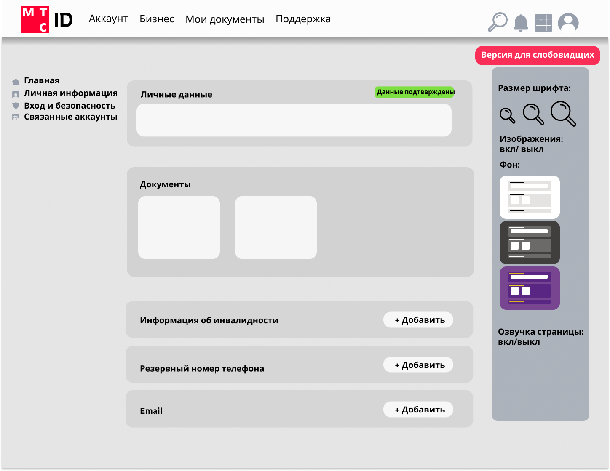
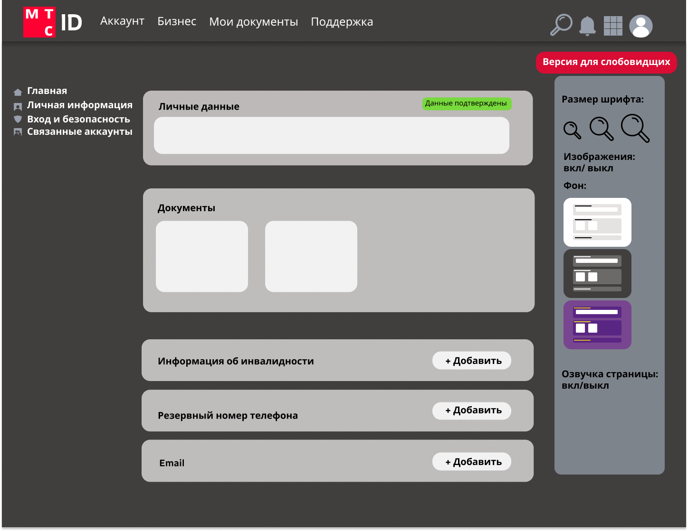

# MTS_TrueTechHack2024
Selected track: ‘Enhancing the MTS Live store experience for users with special needs’.

Выбранный трек: "Улучшение клиентского опыта витрины МТС Live для пользователей с особыми потребностями".

# Team. Команда
- [Mikhail Korotych (Михаил Коротыч)](https://github.com/izen57). Team lead, backender. Капитан команды, бэкенд.
- [Tim Evsigneev (Тимофей Евсигнеев)](https://github.com/Tulenien/). Backender. Бэкенд.
- [Grigorii Korotych (Григорий Коротыч)](https://github.com/io-qar). Frontender. Фронтенд.
- [Anastasia Lisovskaya (Анастасия Лисовская)](https://github.com/NLastya). Frontender. Фронтенд.
- [Yana Poluda (Яна Полуда)](https://github.com/IanaPoluda). Desing. Дизайн.

# Task. Задача
Develop an application to demonstrate the API that has been developed. It includes the following functions:
- user login;
- retrieving, updating and deleting information provided by users with special needs about themselves (health status and aspects);
- retrieving, updating and deleting information regarding the most user-friendly layout of the MTS Live website for users with special needs.

Разработать приложение для демонстрации разработанного API. В него включены следующие функции:
- вход пользователей в систему;
- получение, изменение и удаление информации пользователей с особыми потребностями о себе (состояние и аспекты здоровья);
- получение, изменение и удаление информации о наиболее удобном внешнем виде сайта МТС Live для пользователей с особыми потребностями.

# Technolgies. Технологии
[Java Spring](https://spring.io/), [React](https://react.dev/), [Docker](https://www.docker.com/).

# Class Diagram. Диаграмма классов

# Layout. Макет
https://www.figma.com/design/25DiLZBUsh1Vkq9cl8OtO3/hack_mts?node-id=0%3A1&t=8g5pkUupdApS9EPG-1

# Screenshots. Скриншоты

